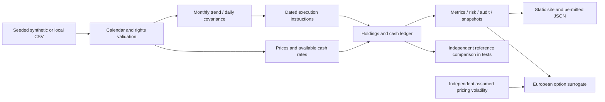

# QIS Index & Risk Lab

A working educational Python project: a volatility-controlled long/cash multi-asset trend index with a self-financing ledger, daily calculation audit, reproducible synthetic study and a separate European option illustration.

**Status:** synthetic engine and static research demo implemented.

[Interactive project website](https://duiyidai.github.io/projects/qis-index-risk-lab/) · [Author homepage](https://duiyidai.github.io/)

 Historical research is **blocked** pending permissioned inputs and rights review. No live trading, client delivery, production deployment or investment recommendation is claimed. AI assisted development; owner review is pending.

## Install and run
Tested with Python 3.11.11; exact tested dependencies are in `requirements-lock.txt`.

```sh
python3.11 -m venv .venv
. .venv/bin/activate
python -m pip install -r requirements-lock.txt
python -m pip install --no-build-isolation --no-deps -e .
pytest -q
ruff check src tests
qis-lab demo
qis-lab build-site
python scripts/research_note.py
python -m http.server 8000 --directory site
```

Open `http://localhost:8000`. Installation requires package downloads; tests, demo, site build and runtime are offline and require no credentials or LLM. `site/index.html` also opens directly because it uses a local script export rather than a fetch call. The site has Research, Risk, Calculation Audit, Methodology and Option Sandbox sections. All numerical paths and option cases come from Python; browser selectors choose existing cases.

Current delivery environment (outside the deliverable): `../../work/venv/bin/`. From this project directory, use `../../work/venv/bin/qis-lab`, `../../work/venv/bin/pytest`, etc., without reinstalling.

## Frozen data and historical commands

```sh
qis-lab validate path/to/snapshot
qis-lab historical private-data/licensed-snapshot --out private-results
```

Historical input requires three documented files: `prices.csv`, `rates.csv`, `metadata.json`. The [data contract and rights status](docs/DATA_RIGHTS.md) and deliberately incomplete [metadata template](fixtures/historical-metadata.template.json) describe the fields. Offline official-cash extraction and modeled availability are documented in [cash availability](docs/CASH_AVAILABILITY.md). No automatic downloader is installed. Historical export to the public site is disabled. The historical command cannot use synthetic data or an assumed cash rate.

To validate a generated demo snapshot, use `results/synthetic/<result_id>/snapshot`, with the ID taken from `results/synthetic/demo.json` or a site manifest. Outputs are content-addressed: rerunning identical input, source and configuration preserves the saved result, and inconsistent collisions fail. Different code/dependency versions yield new IDs even when financial values are unchanged.

## Explore and reconcile
- [Frozen baseline and periods](docs/FREEZE.md), [full methodology](docs/METHODOLOGY.md), [hand-checkable example](docs/MINIATURE.md).
- `results/synthetic/demo.json` contains 13 precomputed baseline/comparison/sensitivity paths, period metrics, daily audit, shocks and option cases. Each version directory includes input snapshot, manifest, ledger, metrics and final state.
- [Computed findings](docs/RESEARCH_FINDINGS.md) adds an interpretation and chronological-period table.
- `site/research-report.md` is computed from actual scenario results. Synthetic input covers 2004-01-02–2025-12-31; actual launch and evaluation dates appear in the results. These are software evidence, not market findings.
- `results/synthetic/revision.json` preserves an old/new synthetic price-correction comparison with dated impacts. Never overwrite a version to conceal a correction.
- [Limitations](docs/LIMITATIONS.md) and [validation evidence](docs/VALIDATION.md) identify what was and was not checked.

Saved-state replay is intentionally small:

```python
import json
from qis_lab.data import synthetic
from qis_lab.engine import run, save_state

data = synthetic()
first, saved = run(data, stop="2016-12-30")
save_state(saved, "state.json")
rest, final = run(data, saved=json.load(open("state.json")))
batch, _ = run(data)
assert first + rest == batch
```

Replay checks the full input prefix before resuming ledger holdings. Rolling decisions are rebuilt from history; this is not a low-latency streaming system.

## Architecture



Modules: `data.py` validates; `signals.py` makes decisions and targets; `ledger.py` solves accounting; `engine.py` schedules and replays; `risk.py` measures; `reporting.py` saves immutable results and builds the site; `pricing.py` is the separate option extension. No database, cloud, broker, runtime LLM or optimization dependency.

## Publication and attribution
Independent GitHub project linked from the owner's homepage. Existing Minimal Mistakes homepage and research-page conventions were inspected read-only; neither was modified. The source repository and synthetic demonstration are published separately from private data. No actual CV modification was performed.

Before publication: owner reviews code/financial logic, licenses, source rights, applicable employer requirements, claims and the exact public files. Publish only the static `site/` directory as the Pages artifact; keep `private-delivery/`, `private-data/` and `private-results/` out of version control and hosting. A disclaimer is not permission. This project does not grant a blanket redistribution license to third-party material. Generated code remains a local review draft; owner chooses its release license.

The ignored `private-delivery/` includes a Chinese owner guide, demonstration/interview preparation, an evidence matrix and draft CV/project wording. Draft wording is not authorization to change the owner's actual CV. See [review log](docs/REVIEW_LOG.md) for the distinction between generated work, automated evidence and owner approval.
